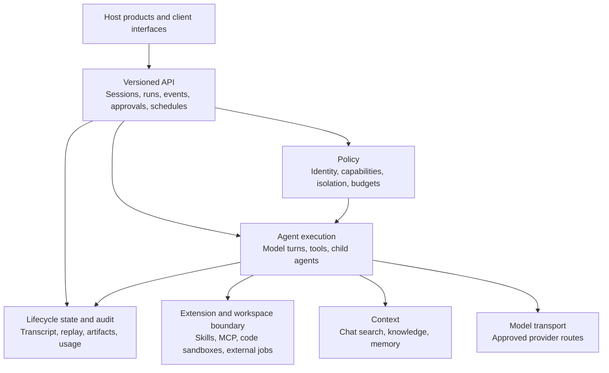
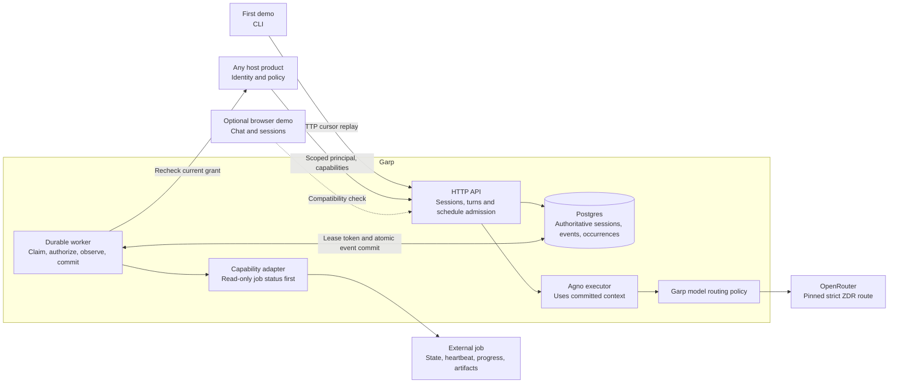
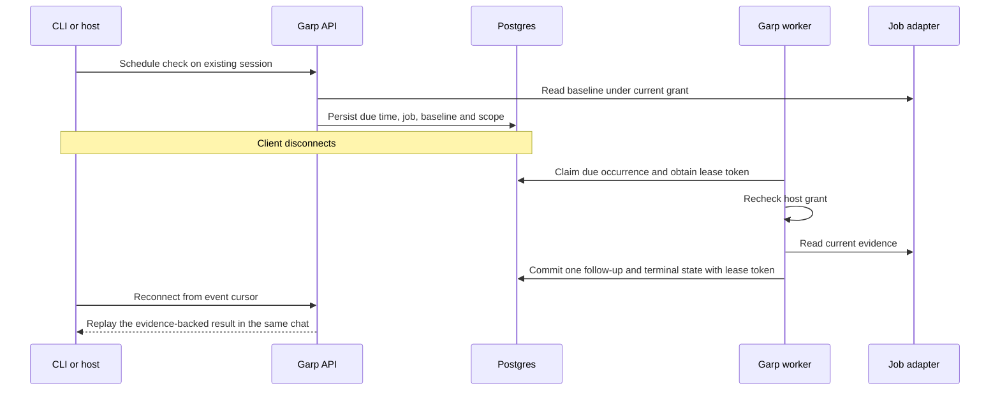

# Garp architecture and first build

20 November 2026

Garp gives a host product a durable agent API. The host supplies identity, workspace policy and capabilities. The user supplies instructions. Garp owns public lifecycle state and commits an authorized result once. Agno runs the model and tool loop. CLI and web clients are consumers of the same API.

## Platform architecture

## First implementation

The model chooses tools and interprets results as those capabilities are added. API and worker policy checks decide access, scheduling and commits. Status comes from typed job observations. A later Rust executor can use the same public API once a candidate passes the same contract tests.

| First build | Scope |
|---|---|
| **Durable state** | Transactional session events, due occurrence claim, lease expiry, stale-worker rejection and progress evidence. |
| **Agno executor** | Caller IDs and committed history, tool execution boundary, pinned OpenRouter policy and synthetic transport tests. |
| **CLI and API** | Session, schedule, worker commands and cursor replay. Show job loss, missed check, revoked access and duplicate delivery in the integration test. |
| **Review** | Verify scope, races, authorization and test results before inviting Joshua and Opus to review the same source. |

The wider harness scope includes delegation, tools and skills, knowledge, memory, cross-chat search, approvals, hosted integrations and observability. The first build proves the shared lifecycle under failure with a synthetic job.

## Run locally

Use Python 3.12 and a dedicated UTF-8 Postgres database. Set these variables in the process environment.

| Variable | Value |
|---|---|
| `GARP_DATABASE_URL` | DSN for the dedicated database |
| `GARP_TOKEN` | Local bearer token, at least 24 printable ASCII characters without spaces |
| `GARP_JOBS_DIR` | Directory containing trusted `<job_ref>.json` observations |
| `GARP_POLICY_FILE` | JSON grant map, for example `{"local:default":["job"]}` |

An observation is a JSON object like `{"instance":"demo-1","observed_at":"2026-11-20T12:00:00Z","state":"running","progress":3}`. Use the actual observation timestamp. Write updates atomically.

Run `uv run --locked garp-api` and `uv run --locked garp-worker` in separate terminals. Create a session with `uv run --locked garp session new`. Schedule using `uv run --locked garp schedule SESSION job --after 60`, then return with `uv run --locked garp events SESSION`. Pass `--after CURSOR` to fetch later events. `uv run --locked garp status SCHEDULE` shows the occurrence state. A completed check can report a running job. A deleted observation file leaves current job state unknown.

Agent turns require `OPENROUTER_API_KEY` and `GARP_OPENROUTER_ZDR_ONLY=true` after verifying the account or guardrail is ZDR only. See the [model selector](cli.md#try-your-openrouter-route) for approved endpoints and overrides. The local job check works without a model call.

The first slice uses a local token and trusted job fixtures. HTTP event replay is implemented. Live SSE, push notifications, browser UI, untrusted tools, host identity adapters, and recurring schedules are later integration work.
