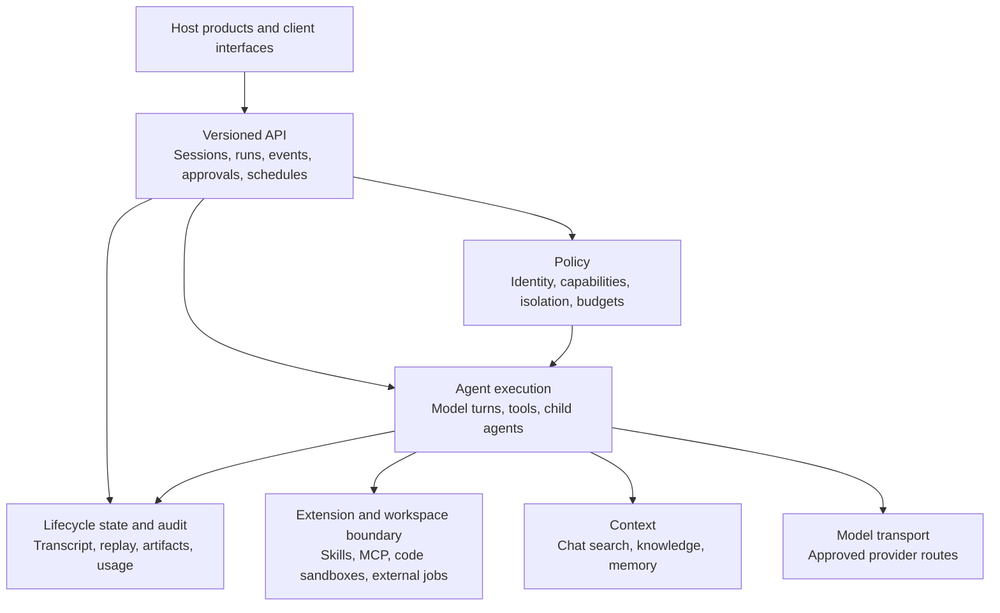
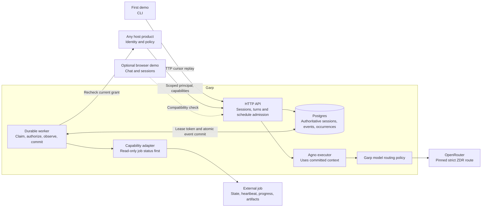
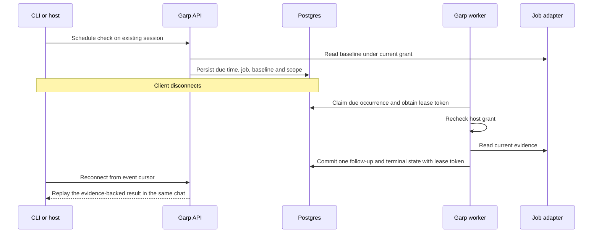

# Garp architecture and first build

20 November 2026

Garp gives a host product a durable agent API. The host supplies identity, workspace policy and capabilities. The user supplies instructions. Garp owns public lifecycle state and commits an authorized result once. Agno runs the model and tool loop. CLI and web clients are consumers of the same API.

## Platform architecture



## First implementation



The model chooses tools and interprets results as those capabilities are added. API and worker policy checks decide access, scheduling and commits. Status comes from typed job observations. A later Rust executor can use the same public API once a candidate passes the same contract tests.



| First build | Scope |
|---|---|
| **Durable state** | Transactional session events, due occurrence claim, lease expiry, stale-worker rejection and progress evidence. |
| **Agno executor** | Caller IDs and committed history, tool execution boundary, pinned OpenRouter policy and synthetic transport tests. |
| **CLI and API** | Session, schedule, worker commands and cursor replay. Show job loss, missed check, revoked access and duplicate delivery in the integration test. |
| **Review** | Verify scope, races, authorization and test results before inviting Joshua and Opus to review the same source. |

The wider harness scope includes delegation, tools and skills, knowledge, memory, cross-chat search, approvals, hosted integrations and observability. The first build proves the shared lifecycle under failure with a synthetic job.

## Run locally

Bare `garp` opens the AgentOS-backed workspace. AgentOS stores chats and turns, streams model output, and runs its native durable queue. Garp imports committed legacy sessions under the local workspace lock before serving requests. It retains the old data for recovery, and writes future messages to AgentOS.

AgentOS manages cron schedules on the standalone `garp serve` service. Garp stores one-shot checks that need an exact due time and optional deadline. The check worker saves a lease-fenced observation before appending a deterministic native assistant run. The same run ID makes delivery retryable across a restart.

See the [CLI guide](cli.md#scripts-and-job-checks) for the native service. The steps below describe the original API and worker, which remain available to legacy clients during the transition.

Use Python 3.12 and a dedicated UTF-8 Postgres database. Set these variables in the process environment.

| Variable | Value |
|---|---|
| `GARP_DATABASE_URL` | DSN for the dedicated database |
| `GARP_TOKEN` | Local bearer token, at least 24 printable ASCII characters without spaces |
| `GARP_JOBS_DIR` | Directory containing trusted `<job_ref>.json` observations |
| `GARP_POLICY_FILE` | JSON grant map, for example `{"local:default":["job"]}` |

An observation is a JSON object like `{"instance":"demo-1","observed_at":"2026-11-20T12:00:00Z","state":"running","progress":3}`. Use the actual observation timestamp. Write updates atomically.

Run `uv run --locked garp-api` and `uv run --locked garp-worker` in separate terminals. Create a session with `uv run --locked garp session new`. Schedule using `uv run --locked garp schedule SESSION job --after 60`, then return with `uv run --locked garp events SESSION`. Pass `--after CURSOR` to fetch later events. `uv run --locked garp status SCHEDULE` shows the occurrence state. A completed check can report a running job. A deleted observation file leaves current job state unknown.

Agent turns require `OPENROUTER_API_KEY` and `GARP_OPENROUTER_ZDR_ONLY=true` after verifying the account or guardrail is ZDR only. See the [model selector](cli.md#try-your-openrouter-route) for approved endpoints and overrides. The local job check works without a model call.

The original API uses a local token and trusted job fixtures. It sends newline-delimited turn updates and exposes an event cursor for saved messages.

## Embed AgentOS in a host

Deploy against a dedicated Postgres database. The host signs a short-lived JWT with a tenant-qualified `sub` such as `org-1:user-7`, the configured `iss` and `aud`, an integer `exp`, and a list of `scopes`. Pass only the RSA public key to Garp. HS256 is also supported with a secret of at least 32 bytes. Keep the local operator token in a separate deployment.

The durable queue stores the verified subject and request scopes at submission. It does not preserve optional profile claims. Scope changes apply to subsequent submissions. A job adapter can independently recheck current resource grants at execution.

```python
import os
from contextlib import asynccontextmanager

from fastapi import FastAPI
from garp.agentos import HostAuth, create_agentos_app

garp = create_agentos_app(
    os.environ["GARP_DATABASE_URL"],
    host_auth=HostAuth(
        issuer="https://identity.example.com",
        audience="garp",
        verification_key=os.environ["GARP_JWT_PUBLIC_KEY"],
    ),
)


@asynccontextmanager
async def lifespan(app):
    async with garp.router.lifespan_context(garp):
        yield


app = FastAPI(lifespan=lifespan)
app.mount("/assistant", garp)
```

Send the JWT as an Authorization bearer. Grant `agents:garp:run` for chat and `sessions:read` for transcript browsing and past-chat tools. Create a session with `POST /sessions` and `{"agent_id":"garp"}` or omit the ID when starting a run. Follow-ups use the ID assigned by AgentOS. Use `memories:read` for recall, `memories:write` for explicit saves, and `memories:delete` for removal. Hosted scheduling uses a job adapter for job checks and a current-scope callback for prompts. [Scheduling](scheduling.md)

`POST /garp/transcripts/search` takes `{"query":"exact phrase"}` and an optional `session_type` of `agent` or `team`. It returns up to 20 owned sessions with excerpts from completed prompts or replies. The model can call `search_chat_transcripts` with `sessions:read`. Deleting a source session removes it from search. Quotations already saved in another chat follow that chat's lifecycle.

Use native AgentOS `DELETE /sessions/{id}` or bulk `DELETE /sessions` with `sessions:delete`. Postgres preserves the deletion if a worker attempts a late save and removes the chat's queue tickets in the same transaction. It retains a chat ID marker and keeps a digest of deleted queue idempotency keys valid for 24 hours. Deletion blocks new handoffs. Specialist chats already admitted keep their own lifecycle. Cancel work first if it must stop before deletion. An already running inline request can return its reply to the original caller without saving it. First startup installs the Postgres triggers and requires schema migration privileges.

## Configure specialists

Pass `specialists=(Specialist("reviewer", "Reviewer", "Review and report findings."),)` to `create_agentos_app`. Import `Specialist` from `garp.delegation`. Hosted installations add specialists explicitly. A parent can delegate only to a specialist the caller can run, such as `agents:reviewer:run`. Assigning new work requires a current host token when the parent calls the tool. The accepted child can finish after that token expires.

`POST /teams/garp-team/runs` accepts the native AgentOS run form and requires `teams:garp-team:run` plus a specialist grant. Native Team delegation gives the coordinator a result in the same turn. The `delegate_task` tool starts a separate chat and returns its IDs after durable queue acceptance. The parent can read the result on a later turn. Each specialist gets the assigned task and its own history under the caller's grant. It receives no parent tools, memory, or web search setting.

AgentOS owns child execution, run storage, and cancellation. Garp supplies the verified owner, reduced grant, and stable parent-child IDs at submission. After worker loss, a model-only child run can retry once under the same IDs. Future child tools with side effects need their own idempotency before they can join this retry path.

See [Garp extensions](extensions.md) for native skill, MCP, knowledge and approval configuration by tenant.

## Inspect execution traces

Pass `tracing=True` when embedding Garp or set `GARP_TRACING=true` for `garp serve`. AgentOS stores trace and span metadata in `garp_traces` and `garp_spans` in the configured Postgres database. Hosted subjects with `traces:read` can list their own traces with `GET /traces?run_id=RUN_ID` and inspect them with `GET /traces/TRACE_ID`. Writes are batched and may take a few seconds to appear.

Traces keep run identity, timing, tool names, and token counts. Garp removes prompts, replies, tool payloads, and free-form errors before export. Use one tracing-enabled Garp app per process because the Agno instrumentation is process-wide. Set `trace_retention_days` on the app or `GARP_TRACE_RETENTION_DAYS` for `garp serve` to expire traces and spans after a positive whole number of days. The sweep uses the latest span end and runs before the app is ready and hourly thereafter. A large existing backlog can delay first startup. Replicas sharing the trace tables should use the same window. [AgentOS tracing](https://docs.agno.com/agent-os/tracing/overview)

### Replica coordination

The durable queue and run records remain in Postgres. For cancellation and stream reconnect across replicas, pass `redis_coordination=RedisCoordination(url=..., key_prefix=...)` from `agno.job_queue.config` to `create_agentos_app`. All replicas sharing a queue need the same Redis and deployment-specific prefix. Separate deployments sharing Redis need distinct prefixes. For standalone replicas, use the same external `GARP_DATABASE_URL`. Set both `GARP_REDIS_URL` and `GARP_REDIS_KEY_PREFIX`; omit both for the default single-process setup. Store credentials in the environment, and use a secured Redis connection.

Agno installs cancellation and stream transports as process-wide globals when the app is constructed. Use one coordinated app per process and configure both transports before constructing it. An explicitly installed transport takes precedence, and a later app cannot switch the first app's transports. Do not mix deployments or Redis settings in one process. Redis outage affects cross-replica cancellation and stream reconnect; Postgres remains the queue authority. Keep queue timing and retention settings consistent across replicas.
